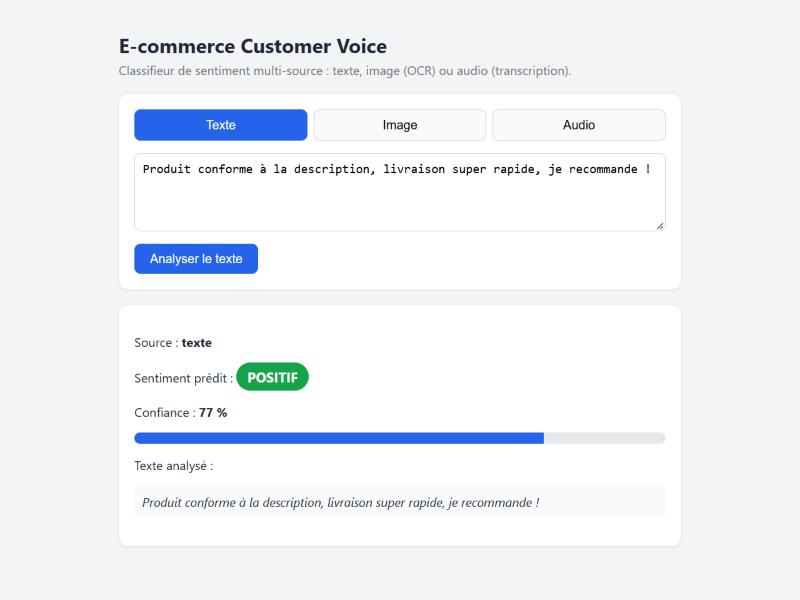
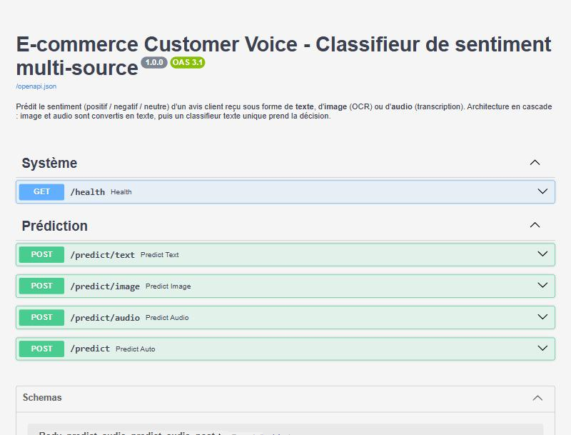

# E-commerce Customer Voice — Classifieur de sentiment multi-source

Mini-projet *ML Appliqué 2026*. Le système prédit le sentiment d'un avis client
(**positif**, **negatif** ou **neutre**), qu'il arrive sous forme de **texte**,
d'**image** (capture d'écran, ticket scanné) ou d'**audio** (message vocal).
Les prédictions sont servies par une API REST **FastAPI** avec une petite page web de test.

## Architecture en cascade

L'image et l'audio sont d'abord **convertis en texte**. Ensuite, c'est **toujours le même
classifieur texte** qui prend la décision :

```
Texte  ───────────────────────────────┐
Image  ── OCR (pytesseract) ──► texte ├──► nettoyage ──► TF-IDF ──► Régression Logistique ──► JSON
Audio  ── ASR (faster-whisper) ► texte┘
```

Toutes les routes renvoient la même réponse JSON :

```json
{
  "source": "image",
  "texte_extrait": "L'appareil ne s'allume plus après 2 jours. Très mauvaise expérience d'achat.",
  "sentiment_predit": "negatif",
  "confiance": 0.5349
}
```

## Structure du projet

```
├── dataset_sentiment_ecommerce/   # jeu de données fourni (textes.csv, images/, audios/)
├── sentiment/                     # logique métier
│   ├── config.py                  #   chemins du projet
│   ├── preprocessing.py           #   nettoyage du texte
│   ├── classifier.py              #   chargement du modèle + prédiction
│   ├── ocr.py                     #   Image -> texte (pytesseract)
│   └── asr.py                     #   Audio -> texte (faster-whisper)
├── models/                        # artefacts : model.pkl, vectorizer.pkl, confusion_matrix.png
├── tessdata/fra.traineddata       # langue française pour Tesseract
├── static/index.html              # mini-application web de test
├── tests/test_api.py              # tests pytest
├── train.py                       # Étape 1 : entraînement
├── evaluate_multimodal.py         # Étape 2 : évaluation OCR + ASR sur le dataset
├── schemas.py                     # schémas Pydantic (validation)
├── main.py                        # Étape 3 : API FastAPI
└── requirements.txt
```

## Installation

**1. Dépendances Python** (Python 3.11 ou plus récent) :

```powershell
python -m venv .venv
.venv\Scripts\activate
pip install -r requirements.txt
```

**2. Logiciel Tesseract** (nécessaire pour l'OCR) :

```powershell
winget install --id UB-Mannheim.TesseractOCR
```

Le code le trouve tout seul dans `C:\Program Files\Tesseract-OCR\`. S'il est installé ailleurs,
définissez la variable d'environnement `TESSERACT_CMD`. La langue française est fournie dans
`tessdata/`, il n'y a rien à faire de plus.

**3. Modèle Whisper** : il est téléchargé automatiquement (~145 Mo) lors de la première
analyse audio. Pas besoin d'installer ffmpeg.

## Utilisation

| Étape | Commande |
|---|---|
| 1. Entraîner le modèle | `python train.py` |
| 2. Évaluer OCR + ASR sur le dataset | `python evaluate_multimodal.py` |
| 3. Lancer l'API | `uvicorn main:app --reload` |
| 4. Mini-application web | ouvrir http://127.0.0.1:8000/ |
| 4. Documentation Swagger / ReDoc | http://127.0.0.1:8000/docs et http://127.0.0.1:8000/redoc |
| 5. Lancer les tests | `pytest -v` |

Les modèles `.pkl` sont déjà fournis dans `models/` : l'étape 1 n'est utile que pour réentraîner.

### Routes de l'API

| Méthode | Route | Entrée |
|---|---|---|
| GET | `/health` | — |
| POST | `/predict/text` | JSON `{"texte": "..."}` |
| POST | `/predict/image` | fichier `fichier` (PNG/JPEG, 5 Mo max) |
| POST | `/predict/audio` | fichier `fichier` (WAV/MP3, 10 Mo max) |
| POST | `/predict` | champ `texte` **ou** fichier `fichier` : le type est détecté automatiquement |

Exemples en ligne de commande :

```powershell
curl.exe -X POST http://127.0.0.1:8000/predict/text -H "Content-Type: application/json" -d "{\"texte\": \"Livraison rapide, je recommande !\"}"
curl.exe -X POST http://127.0.0.1:8000/predict/image -F "fichier=@dataset_sentiment_ecommerce/images/I05.png"
curl.exe -X POST http://127.0.0.1:8000/predict/audio -F "fichier=@dataset_sentiment_ecommerce/audios/A02.mp3;type=audio/mpeg"
```

Toute entrée invalide renvoie **422 Unprocessable Entity** : texte vide, mauvais type MIME,
fichier trop gros, fichier corrompu ou image sans texte.

## Captures d'écran

**Mini-application web** (http://127.0.0.1:8000/) :



**Documentation interactive Swagger** (http://127.0.0.1:8000/docs) :



## Choix techniques et résultats

### Étape 1 — Classifieur texte (`train.py`)

- **Nettoyage** : minuscules, suppression des accents, de la ponctuation et des stop-words.
  Les mots de **négation** (`ne`, `pas`, `aucun`, `sans`…) sont **gardés**, car ils inversent le sentiment.
- **Vectorisation** : `TfidfVectorizer` sur des **n-grammes de caractères** (3 à 5).
  Avec seulement 24 phrases d'entraînement, la plupart des mots du test n'ont jamais été vus.
  Les morceaux de mots rapprochent `recommande` / `recommanderai` et tolèrent les petites
  erreurs de l'OCR. Sur le test externe, cela donne 89 % contre 83 % avec des mots entiers.
- **Modèle** : **Régression Logistique**, comparée à un SVM linéaire. On la garde car elle donne
  des **probabilités**, qui servent de score de `confiance`.
- **Évaluation** : textes de référence des images et audios (18 avis jamais vus) :

| Classe | Précision | Rappel | F1 |
|---|---|---|---|
| positif | 0.86 | 1.00 | 0.92 |
| negatif | 0.83 | 0.83 | 0.83 |
| neutre | 1.00 | 0.83 | 0.91 |
| **Accuracy** | | | **0.89** |

La matrice de confusion est enregistrée dans `models/confusion_matrix.png`.
La validation croisée sur les 24 textes seuls donne un score faible (≈ 0.33) : chaque pli
n'a que 6 phrases de test, donc ce chiffre est très instable. Avec si peu de données, il faut
le lire comme une limite du dataset.

### Étape 2 — OCR et ASR (`evaluate_multimodal.py`)

| Pipeline | Outil | Ressemblance texte extrait / référence | Sentiments corrects |
|---|---|---|---|
| Image | pytesseract (langue `fra`) + Pillow (niveaux de gris) | 86.9 % | 7 / 9 |
| Audio | faster-whisper `base` (CPU, int8) | 98.9 % | 8 / 9 |

- **OCR** : le texte est bien lu. L'écart vient du bandeau « CAPTURE AVIS CLIENT — Ixx.png » et des étoiles ★.
- **ASR** : `faster-whisper` est une version allégée de Whisper. Il tourne sur CPU et lit
  directement les `.wav` et `.mp3`, sans ffmpeg. Remarque : `audios.csv` indique des fichiers `.wav`
  alors que le dossier contient des `.mp3`. L'API accepte les deux formats.
- Les erreurs restantes viennent du **classifieur** (24 exemples), pas de l'extraction.
  Plus de données d'entraînement serait l'amélioration la plus efficace.

### Étape 3 — API (`main.py`, `schemas.py`)

- Routes FastAPI séparées par source, plus une route `/predict` à détection automatique
  (selon le type MIME `image/...` ou `audio/...`).
- **Pydantic** valide le corps JSON (`TexteRequete`), ainsi que le type MIME et la taille des
  fichiers (`FichierImage`, `FichierAudio`). Il impose aussi le format de la réponse (`PredictionReponse`).
- Les modèles (scikit-learn et Whisper) sont chargés **une seule fois**, puis gardés en mémoire.

### Étape 4 — Application web (`static/index.html`)

Option B : page HTML/JS servie par FastAPI elle-même, donc une seule commande à lancer.
Elle propose trois onglets (Texte, Image, Audio) et appelle l'API avec `fetch`.
Elle affiche le sentiment avec un badge coloré et une barre de confiance.
L'option A (Swagger `/docs`) est aussi disponible.

### Étape 5 — Tests (`tests/test_api.py`)

23 tests `pytest` avec `TestClient` (httpx) :

- tests unitaires du nettoyage de texte ;
- `200 OK` et structure JSON vérifiée pour chaque route, sur de vrais fichiers du dataset ;
- `422` pour les entrées invalides : champ manquant, texte vide, mauvais type, fichier trop gros,
  image corrompue, type inconnu.

```
23 passed
```
